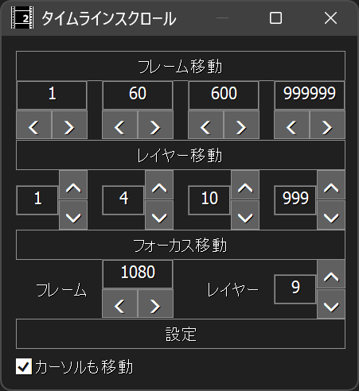

# 🐍AviUtl2 タイムラインスクロールプラグイン

* aviutl2のタイムラインをスクロールします。

## 🚀インストール

* `プラグインフォルダ`に以下のファイルを入れてください。
	* `al2` ✏️フォルダ
		* `al2_timeline_scroller.aux2` ✏️汎用プラグインファイル

## 🔥アンインストール

* `プラグインフォルダ`から以下のファイルを削除してください。
	* `al2` ✏️フォルダ
		* `al2_timeline_scroller.aux2` ✏️このファイルを削除
		* `al2_timeline_scroller` ✏️このフォルダを削除

## 🎨タイムラインスクロールウィンドウ

* `フレーム移動`✏️タイムラインをフレーム方向(横)にスクロールします。
	* エディットボックスに入力されているフレーム数分だけ左右にスクロールします。
----
* `レイヤー移動`✏️タイムラインをレイヤー方向(縦)にスクロールします。
	* エディットボックスに入力されているレイヤー数分だけ上下にスクロールします。
----
* `フォーカス移動` ✏️フォーカスを移動します。
	* `フレーム` ✏️左右にあるオブジェクトにフォーカスを移動します。
	* `レイヤー` ✏️上下にあるオブジェクトにフォーカスを移動します。
		* ※開始位置が最も近いオブジェクトにフォーカスが移動します。
----
* `設定`
	* `カーソルも移動` ✏️スクロールと同時にカーソル位置も変更します。

## 💡使い方

1. aviutl2ウィンドウのメニューで`表示`➡`タイムラインスクロール`を選択します。
1. `タイムラインスクロール`ウィンドウが表示されます。
1. `タイムラインスクロール`ウィンドウでボタンを押します。
1. タイムラインがスクロールされます。またはフォーカスが移動します。

### 🏷️設定を初期化する

1. aviutl2を起動していない状態で`プラグインフォルダ\al2\al2_timeline_scroller\config`を削除してください。

## 🔖更新履歴

* 🔖r1 2026年10月24日
	* 🎉初版
